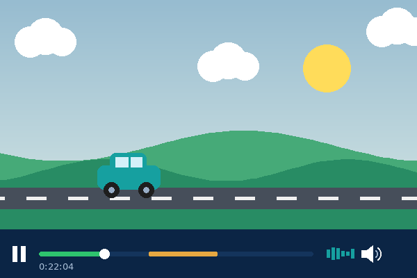
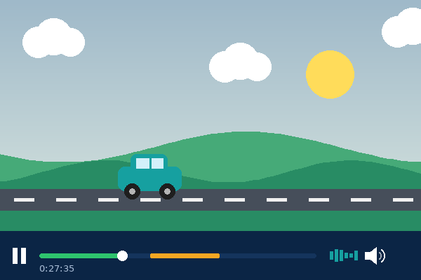

<div align="center">

# Salik • سالك

**Watch movies and series with your family, with peace of mind.**
**اتفرج على الأفلام والمسلسلات مع عيلتك وانت مطمن.**

Free & open-source · Chrome · Android · Android TV

[English](#english) · [العربية](#العربية)

</div>

---

## English

Salik is a free, open-source tool that **skips, blurs or mutes** sensitive scenes and language while you watch on official streaming platforms. It is a charitable project (waqf). It is free forever, with no subscriptions and no ads.

Salik does not host, download or modify any video content. It only controls playback in the platform's own player, based on a timed filters library.

### Platforms

| Platform | How to install |
|---|---|
| 💻 **Chrome extension** | Install from the [Chrome Web Store](https://chromewebstore.google.com/detail/salik-%E2%80%A2-%D8%B3%D8%A7%D9%84%D9%83/ngehcikconlnhlhhfbgemloihlkmiibb) → **Add to Chrome** |
| 📱 **Android** | Download the `.apk` from [Releases](../../releases) → open it → allow installing from unknown sources |
| 📺 **Android TV** | Download the TV `.apk` from [Releases](../../releases) and install it with a sideloading app (e.g. *Downloader*) or a USB drive |

### How it works

Every title in the library has a timeline of filters. When playback reaches a filter's start time, Salik applies one of three actions until the end time:

| Skip | Blur | Mute |
|:---:|:---:|:---:|
|  |  |  |
| Jumps over the scene | Covers the picture | Silences the audio |

The amber part of the timeline is the filtered segment.

### Categories

Each category can be turned on or off from the settings:

- 🔞 **Sensitive scenes**: nudity and suggestive content
- 🩸 **Violence & gore**: excessive cruelty or physical harm
- 🤬 **Language**: profanity and swearing
- 🚬 **Substance use**: smoking, alcohol and drugs

### Project structure

```
library/<key>.json        One file per title: title info + its filters (start, end, action, category)
library.json              Generated combined library downloaded by the apps. Do not edit by hand.
scripts/build-library.js  Builds library.json from library/
app-config.js             Repo, library and donation links
subtitle-censor-core.js   Subtitle word blacklist (keep in sync with main.script.js)
main.script.js            Subtitle word blacklist (keep in sync with subtitle-censor-core.js)
app/i18n.js               Arabic (RTL) / English (LTR) UI
```

Titles may include `title_en` and `description_en`, and filters may include `description_en`, for the English UI.

### Contributing

Every contribution is welcome, from a single missed scene to a whole new title.

**Report without code:** open an [Issue](../../issues) with the title, platform, timestamp and what should be filtered.


### Support the project

Salik is and will always be free. Donations are **optional** and are not commercial profit. They go entirely to keeping the project running: server costs, developing new features, and operating expenses, so its benefit can keep growing. Donation links are available inside the apps.

### License

[MIT](LICENSE)

---

<div dir="rtl">

## العربية

**سالك** أداة مجانية ومفتوحة المصدر بتعمل **تخطي أو تمويه أو كتم** للمشاهد والألفاظ غير المناسبة، وانت بتتفرج على منصات البث الرسمية. المشروع **وقف خيري لوجه الله**، مجاني للأبد، من غير اشتراكات ولا إعلانات.

سالك مش بيستضيف ولا بينزّل ولا بيعدّل أي محتوى. هو بس بيتحكم في التشغيل داخل مشغل المنصة نفسها، بناءً على مكتبة فلاتر بتوقيتات.

### المنصات

| المنصة | طريقة التثبيت |
|---|---|
| 💻 **إضافة كروم** | ثبّتها من [Chrome Web Store](https://chromewebstore.google.com/detail/salik-%E2%80%A2-%D8%B3%D8%A7%D9%84%D9%83/ngehcikconlnhlhhfbgemloihlkmiibb) ← **Add to Chrome** |
| 📱 **أندرويد** | نزّل ملف `.apk` من [Releases](../../releases) ← افتحه ← اسمح بالتثبيت من مصادر غير معروفة |
| 📺 **أندرويد TV** | نزّل ملف `.apk` الخاص بالتلفزيون من [Releases](../../releases)، وثبّته عن طريق تطبيق زي *Downloader* أو فلاشة |

### بتشتغل إزاي؟

كل فيلم أو مسلسل في المكتبة ليه جدول زمني للفلاتر. أول ما الفيديو يوصل لبداية أي فلتر، سالك بيطبّق واحد من 3 إجراءات لحد نهايته:

| تخطي | تمويه | كتم |
|:---:|:---:|:---:|
|  |  |  |
| يعدّي المشهد | يغطي الصورة | يكتم الصوت |

الجزء البرتقالي في شريط التشغيل هو المقطع اللي بيتفلتر.

### الفئات

كل فئة تقدر تفعّلها أو تلغيها من الإعدادات:

- 🔞 **المشاهد الحساسة**: العري والإيحاءات
- 🩸 **العنف والمحتوى المقزز**: القسوة المفرطة والإيذاء الجسدي
- 🤬 **الألفاظ**: الشتائم والألفاظ البذيئة
- 🚬 **التعاطي**: التدخين والمسكرات والمخدرات

### المساهمة

أي مساهمة مرحب بيها، من مشهد واحد فات لحد فيلم كامل جديد.

**من غير كود:** افتح [Issue](../../issues) واكتب اسم العمل والمنصة والتوقيت واللي محتاج يتفلتر.


### دعم المشروع

سالك مجاني وهيفضل مجاني. التبرعات **اختيارية ومش إجبارية**، ومش ربح تجاري. بتروح بالكامل لاستمرار المشروع: تكاليف السيرفرات، وتطوير مميزات جديدة، ومصاريف التشغيل، عشان الأثر يفضل ممتد. لينكات التبرع موجودة جوه التطبيقات.

### الترخيص

[MIT](LICENSE)

</div>
